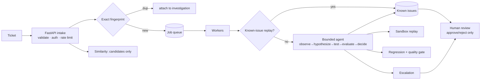

# Codenta AI — Coding Pipeline Diagnostic Agent (prototype)

> **This is a portfolio / interview follow-up prototype, NOT an official Codenta project.**
> It uses **synthetic data only**. It has no access to, and makes no claims about, Codenta's private
> systems, prompts, source code, or production datasets. The "production pipeline" in this repo is a
> deterministic simulation built to reproduce the trace from the interview debugging exercise.

A separate, bounded AI diagnostic agent that investigates **incorrect dental CDT-code predictions that
passed QA** in a fixed multi-stage LLM pipeline (extraction → coding → QA). It finds root causes with
sandbox experiments, deduplicates incoming tickets without merging different problems, validates
candidate fixes against a regression suite, and hands humans a short, ranked list of decisions.

- Not deployed anywhere. Everything below runs locally.

---

## 1. Problem and interview context

The debugging exercise: a clinical note, a seat-billing practice policy, and a wrong prediction that
passed QA.

> "#14 cracked, pt c/o pain on biting. 1 PA taken. Prepped #14 for crown, temp placed, impression to lab.
> Discussed gold and all-ceramic; pt chose all-ceramic. Also #19 MO composite filling done today.
> Seat #14 in 2 wks."

| | |
|---|---|
| Predicted | `D0220, D2392, D2790` (QA passed) |
| Extraction (crown) | `status: completed`, `material: gold` |
| Expected (seat billing) | `D0220, D2392` |
| Expected (prep billing) | `D0220, D2392, D2740` |

Changing D2790 → D2740 is not sufficient. The candidate causes are material extraction (A), status
extraction (B), coding policy application (C) and QA (D), possibly several at once, and the prompt
should not be assumed to be the culprit.

**Result** ([full report](docs/crown_root_cause_report.md)): A is supported but *latent* under seat
billing; B is *sufficient and necessary*; the v1 schema cannot represent "prepared" (structural);
C is **refuted**; D is supported (QA never re-reads the note). The regression suite then exposed a fourth
defect not visible in the ticket: the pipeline silently defaults to prep billing when the policy is
missing.

## 2. Solution overview



Full diagrams (system, lifecycle, agent loop): [docs/architecture.md](docs/architecture.md).
Design rationale: [docs/design.md](docs/design.md).

| Component | What it does |
|---|---|
| **Simulated pipeline** (`pipeline/`) | Deterministic stand-ins for the extraction / coding / QA stages, parameterized by versioned schemas, prompts, rule card, policies and QA rules. Reproduces the interview trace exactly. Labelled `simulated`. |
| **Intake** (`intake/`, `api/`) | Validated reports (must match the saved run), stable IDs, idempotent ticket IDs, per-principal rate limit, soft/hard backpressure (429 + Retry-After), audit. |
| **Dedup** (`dedup/`) | (1) exact fingerprint with DB UNIQUE constraint; (2) similarity retrieval: metadata prefilter + embedding cosine, *candidates only*; (3) confirmed root-cause grouping: known issues, parent/child, symptom signatures, resolution history. |
| **Agent** (`agent/`) | Deterministic controller enforcing budgets (steps, experiments, regression runs, tokens, cost, deadline), typed tools, checkpointing, citation verification, escalation reports. Pluggable reasoner: `deterministic-demo` or Claude. |
| **Sandbox replay** (`sandbox/`) | Replays from saved traces with field overrides, candidate config changes or counterfactual billing events. Deterministic experiment IDs, cached. Never touches production config. |
| **Evaluation** (`evaluation/`, `data/eval/`) | 27-case synthetic dataset across 17 categories; precision, recall, F1, exact match, escaped errors, false holds, policy violations, per-category metrics, regressions; quality gate. |
| **Fix generator** (`agent/fixes.py`) | Narrowest catalog change per confirmed cause → regression run → gate → attribute regressions → swap remedy / add companion → retry or escalate. |
| **Queue + workers** (`jobs/`) | DB-backed queue: atomic claims, priority, leases + heartbeats, crash resume from checkpoint, exponential backoff with jitter, dead-letter + requeue, bounded worker pool, shared LLM rate limiter. |
| **Review + dashboard** (`review.py`, `api/dashboard.py`) | One decision per change set / escalation question, ranked by severity × affected tickets; evidence highlighted in the note; approve/reject (never deploys). |
| **Metrics** (`metrics.py`) | Keeps diagnosed incidents, validated fix proposals, human-approved fixes and affected tickets as separate counts; work avoided; latency percentiles (no SLA claim). |
| **Config registry** (`config/`) | Versioned YAML for rule cards, schemas, lexicon, policies, QA rules, pipeline versions, candidate fixes, agent budgets/gate. Fingerprinted into cache keys. |

### What is real LLM reasoning vs deterministic

| Part | Implementation |
|---|---|
| Production pipeline stages | **Deterministic simulation** (no LLM). Stands in for LLM stages so failures are reproducible. |
| Investigation reasoner, default | **`deterministic-demo`**: a scripted, rule-based investigation policy. **Not an LLM.** Labelled as such in the API, reports and dashboard. Runs without an API key. |
| Investigation reasoner, optional | **Claude** via Anthropic tool use (`CODENTA_REASONER=claude`, `ANTHROPIC_API_KEY`). Same controller, tools, budgets and verification. **Tested only with a mocked Anthropic client** in this repo; not run against the live API. |
| Observations, sandbox, regression, quality gate, fix generation, dedup | Deterministic code in both modes. |

## 3. Install and run

Requires Python 3.12. No AWS credentials and no paid API key needed.

```bash
uv venv --python 3.12 .venv && uv pip install -e ".[dev,llm,postgres]"   # or: make install
make test        # 92 tests
make demo        # demos A–E end to end through the HTTP API on a fresh temp DB
make reports     # regenerate docs/generated/*.md from real runs
make load        # synthetic load test (prints measured numbers)
make serve       # API + in-process workers on :8000; dashboard at /dashboard (key: dev-reviewer)
```

Docker (PostgreSQL + API + 2 worker replicas): `docker compose up --build`. *The Dockerfile and
compose file are provided but were **not built or run** in the development environment (Docker was not
available). The PostgreSQL code path itself was verified separately, see §5.*

Optional Claude reasoner: `CODENTA_REASONER=claude ANTHROPIC_API_KEY=... make serve`.

Dev API keys (refused unless `CODENTA_ENV=dev`): `dev-reporter-seat` (P-SEAT-01), `dev-reporter-prep`
(P-PREP-02), `dev-reviewer`, `dev-admin`.

## 4. Demo walkthrough (`make demo`)

All checks below are asserted by `scripts/demo.py` and by `tests/test_demos.py`.

| Demo | What happens | Status |
|---|---|---|
| **A** — interview case | 14 reasoning steps, 12 experiments, 0 LLM calls. A supported (latent), B supported (sufficient + necessary), schema supported (structural), C refuted, D supported, model capability untestable. Two bundles rejected by the gate, third passes (F1 0.8214 → 1.0, 0 regressions). | passes |
| **B** — prep-billing practice | Same note, prep policy. Material-only and status-only corrections both fail; combined → `D0220, D2392, D2740`. Both causes *necessary*. | passes |
| **C** — 25 duplicate tickets | 1 canonical investigation, 1 job, `report_count` 25, priority bumped; reasoning steps avoided reported from measured steps. | passes |
| **D** — similar but different | Wrong material (D-001), wrong stage (D-002), missing policy (D-003) get three different confirmed root causes despite similarity scores up to ≈0.99. Overlapping errors (D-004) are linked to A's known issue only after A's validated fix replays correctly on it (0 reasoning steps). | passes |
| **E** — gate rejection + escalation | Regressing bundles are rejected with attributed reasons and revised. A ticket whose label requires facts the note doesn't document escalates (`label_documentation_conflict`) instead of guessing; a second one with the same question is grouped into the same human decision. Budget exhaustion also escalates with a do-not-repeat list. | passes |

End of the full demo: 33 tickets → 8 canonical investigations → **2 human decisions** (one change set
validated independently by 5 investigations, one escalation question covering 2 tickets).

## 5. What was tested (actually executed)

* **92 automated tests pass** (`make test`). Files: `test_pipeline` (11), `test_sandbox` (8),
  `test_evaluation` (7), `test_agent` (17), `test_intake_dedup` (10), `test_demos` (15), `test_queue` (8),
  `test_security` (10), `test_api_extras` (6).
* **The same 92 tests and `scripts/demo.py` also pass against PostgreSQL 16.2** (embedded server via
  `pgserver`, using `CODENTA_TEST_DATABASE_URL`; three consecutive clean runs). This surfaced a real race
  that SQLite's serialized writes hide: concurrent investigations creating the same known issue. It is
  fixed with `INSERT … ON CONFLICT DO NOTHING` + `SELECT … FOR UPDATE` in a global lock order. The Docker
  Compose Postgres service itself was not run.
* **Live server smoke test**: `uvicorn` with background workers; a ticket was filed over HTTP and reached
  `fix_validated`; the report, review queue and OpenAPI endpoints were served; the server log contained no
  note text.
* Covered: validation, auth (401/403), practice isolation (404 on out-of-scope), idempotency/409,
  concurrent duplicate submissions (16 threads → 1 investigation), backpressure and rate limiting, all
  demos, fast path on/off, budget exhaustion in every dimension (unit level) and end-to-end escalation on
  exhaustion, adversarial reasoner citations, Claude
  tool loop and token budget with a mocked client, worker crash → resume from checkpoint, retries →
  dead-letter → requeue, lease recovery, no double claims under concurrency, priority, audit contents,
  read-only traces, unchanged production config, dashboard login/review flow.
* **Not tested:** live Claude API, Docker build, AWS anything, real clinical notes.

### Measured load-test results (one local run, not an SLA or benchmark)

`python scripts/load_test.py --tickets 1000 --unique-runs 60 --workers 4` (SQLite, in-process TestClient,
deterministic reasoner, a developer laptop):

| Measure | Value |
|---|---|
| Tickets → canonical investigations | 1,000 → 60 (940 exact duplicates) |
| Full agent investigations | 7 (39 resolved by known-issue replay, 14 grouped escalations); 6 in an earlier run. The variation comes from concurrent identical tickets starting before a parent finishes |
| Validated fix proposals / distinct change sets | 6 / 1 |
| Reasoning steps executed / avoided | 71 / 6,559 (6,000 by dedup, 559 by replay). "Avoided" is a proxy: duplicates × steps of the canonical investigation |
| Intake | 73 req/s, p50 12 ms, p95 20 ms |
| Queue drain | 60 jobs in 5.0 s (4 workers) |
| Backpressure run (`--hard-limit 20`, 300 tickets) | 20 accepted new, 210 duplicates accepted, 70 rejected with 429 |

## 6. API examples

```bash
# File a ticket (predicted codes must match the saved run)
curl -s -X POST localhost:8000/v1/issues -H "X-API-Key: dev-reporter-seat" -H "Content-Type: application/json" -d '{
  "ticket_id": "TCK-A-001", "practice_id": "P-SEAT-01", "source_note_id": "N-1001",
  "pipeline_run_id": "RUN-1001", "predicted_codes": ["D0220","D2392","D2790"],
  "expected_codes": ["D0220","D2392"], "error_description": "Gold crown billed at prep visit",
  "policy_version": "P-SEAT-01@v3", "pipeline_version": "v1.3", "severity": "high", "reporter_id": "qa-1"}'
# → 201 {"investigation_id": "INV-…", "duplicate": false, "similar_candidates": [...], ...}  (200 if duplicate)

curl -s localhost:8000/v1/investigations/INV-… -H "X-API-Key: dev-reviewer"            # full state
curl -s localhost:8000/v1/investigations/INV-…/report.md -H "X-API-Key: dev-reviewer"  # markdown report
curl -s localhost:8000/v1/investigations/INV-…/similar -H "X-API-Key: dev-reviewer"    # candidates only
curl -s localhost:8000/v1/review-queue -H "X-API-Key: dev-reviewer"
curl -s -X POST localhost:8000/v1/fixes/FIX-…/review -H "X-API-Key: dev-reviewer" \
     -H "Content-Type: application/json" -d '{"decision": "approve", "notes": "ok"}'      # never deploys
curl -s localhost:8000/v1/metrics -H "X-API-Key: dev-reviewer"
curl -s -X POST localhost:8000/v1/investigations/INV-…/sandbox-replay -H "X-API-Key: dev-reviewer" \
     -H "Content-Type: application/json" \
     -d '{"label": "check", "field_overrides": {"crown.status": "prepared"}}'
curl -s -X POST localhost:8000/v1/admin/process -H "X-API-Key: dev-admin"               # drain queue now
curl -s -X POST localhost:8000/v1/dev/demo-scenarios/a -H "X-API-Key: dev-admin"        # dev only: run demo A–E
curl -s localhost:8000/v1/pipeline-runs -H "X-API-Key: dev-reporter-seat"              # saved runs in your scope
```

OpenAPI docs at `/docs` when the server is running.

## 7. Tradeoffs

* **Deterministic simulated pipeline instead of real LLM stages.** Failures are reproducible and testable,
  but "model capability" can't be tested, and the extraction defects are modelled, not observed.
* **Deterministic demo reasoner as default.** The demo runs anywhere and is honest about what it is, but it
  encodes an investigation strategy rather than discovering one. The Claude reasoner is where open-ended
  reasoning would come from; the controller makes both equally accountable.
* **Fix search over a small catalog** of pre-authored candidate changes. Safe and auditable, but it can't
  invent a new prompt. When the catalog is exhausted the agent escalates rather than improvising.
* **Strict gate (0 regressions)** blocks partial improvements; thresholds live in `config/agent.yaml`.
* **DB-backed queue** keeps local development to one dependency; SQS is the production mapping.
* **Hashed-feature embedding** instead of a text-embedding model: features are structured (codes, stages),
  and pgvector is the documented production path.

## 8. Limitations

* 27 synthetic eval cases designed alongside the simulated pipeline: **F1 1.0 there is not evidence of
  real-world accuracy**.
* The phrase lexicon used for note evidence is small and English-only; real notes would need a stronger
  (likely LLM-assisted, then verified) evidence extractor.
* The fast path can miss reuse when identical tickets are processed concurrently (observed: 5–6
  independent validations of the same change set in load-test runs).
* Single rule card; no CDT rules beyond the interview card except three documented synthetic assumptions.
* API-key auth only; OIDC is a design note. AWS deployment is a design note.

## 9. Future work

* Run the Claude reasoner on the demo set and compare its steps, cost and verdicts against the deterministic
  baseline (same verification applies).
* Replace the simulated extraction with recorded real model outputs and repeated sampling to test model
  capability and nondeterminism.
* LLM-proposed candidate changes (new prompt text), still validated by the same sandbox + gate.
* Per-signature advisory lock so concurrent identical tickets wait for the in-flight parent.
* pgvector + HNSW for similarity; SQS workers; OIDC.
* Growing the regression set from confirmed incidents (with human-verified labels).

## Repository map

```
config/            versioned rule card, schemas, lexicon, policies, QA rules, pipelines, candidate fixes, agent budgets
data/              synthetic production store, eval dataset, demo tickets, interview fixture
src/codenta_diag/  pipeline · intake · dedup · agent · sandbox · evaluation · jobs · db · api · review · metrics
scripts/           demo.py · load_test.py · smoke_agent.py
tests/             92 tests
docs/              architecture · design · crown_root_cause_report · security · aws_deployment · demo_script · follow_up_email · generated/
```
