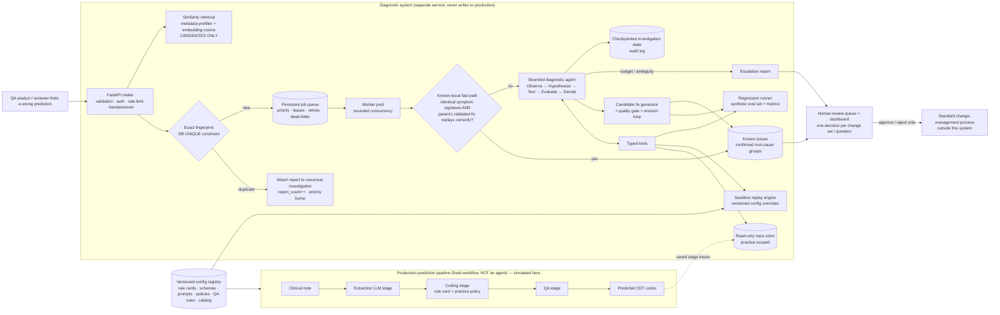
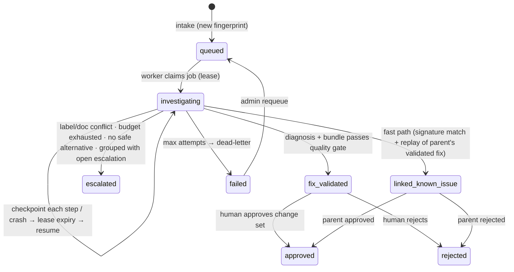
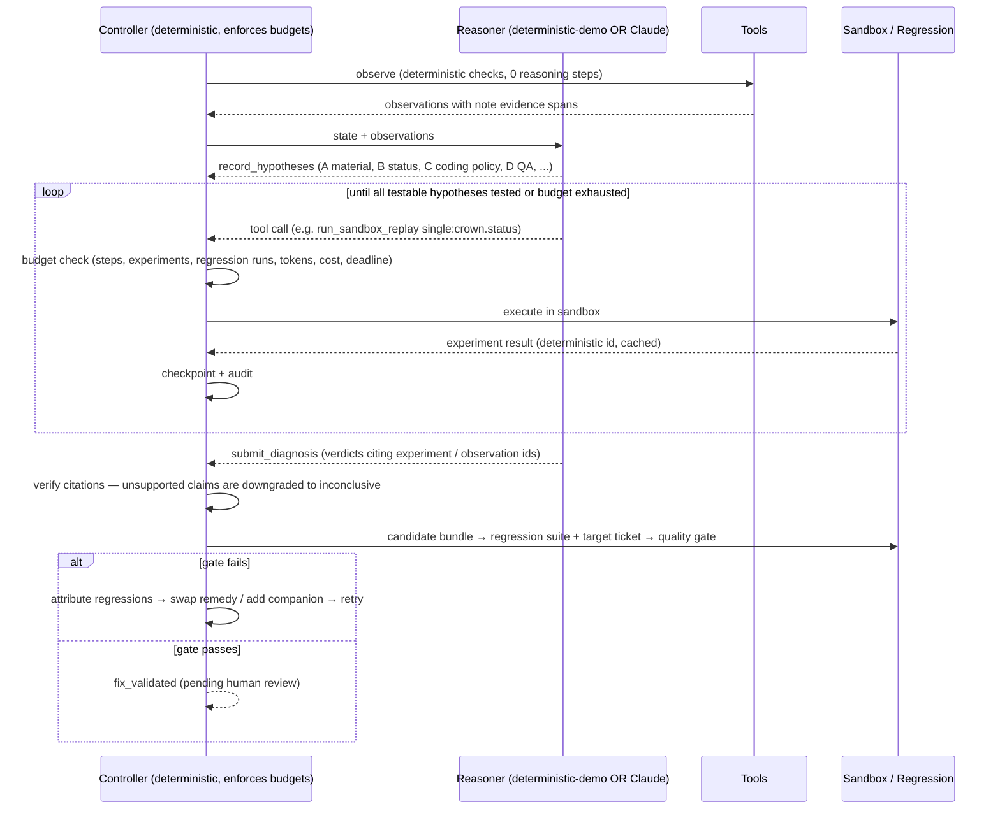

# Architecture

> Independent portfolio / interview follow-up prototype — not an official Codenta project. Synthetic data only.

## System overview

The arrow from the review queue to change management is the only path toward production, and it
is a human decision. The diagnostic system has no write access to production prompts, schemas,
policies or traces.

## Investigation lifecycle

## Agent loop (one investigation)

## Code map

| Area | Module |
|---|---|
| Simulated production pipeline | `src/codenta_diag/pipeline/` (`extraction.py`, `coding.py`, `qa.py`, `runner.py`, `lexicon.py`) |
| Versioned configuration | `config/` + `src/codenta_diag/config_registry.py` |
| Intake + validation | `src/codenta_diag/intake/` |
| Dedup (fingerprint, similarity, grouping) | `src/codenta_diag/dedup/` |
| Agent (controller, reasoners, tools, fixes, reports) | `src/codenta_diag/agent/` |
| Sandbox replay | `src/codenta_diag/sandbox/` |
| Evaluation + quality gate | `src/codenta_diag/evaluation/` |
| Queue, workers, rate limiting | `src/codenta_diag/jobs/` |
| Persistence | `src/codenta_diag/db/` (SQLAlchemy; SQLite or PostgreSQL) |
| API + dashboard | `src/codenta_diag/api/` |
| Metrics, review | `src/codenta_diag/metrics.py`, `src/codenta_diag/review.py` |
